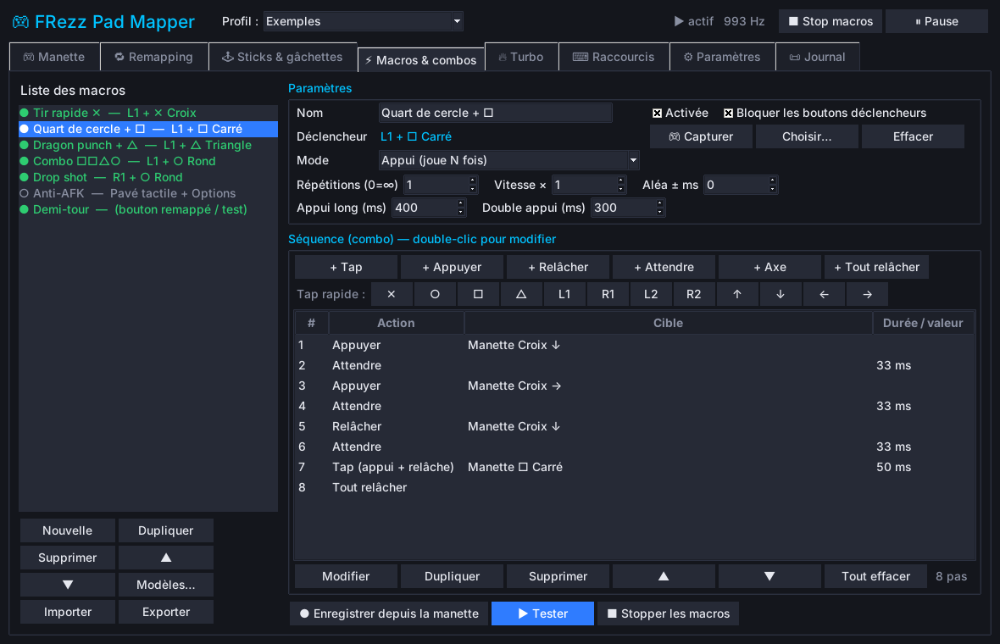

# 🎮 FRezz Pad Mapper

Logiciel de **remappage** et de **macros** pour manette **PS5 (DualSense)** sur PC Windows.



## Fonctionnalités

| | |
|---|---|
| 🔁 **Remapping** | Chaque bouton → bouton de manette virtuelle, touche clavier, clic souris, molette, macro ou action (profil suivant, pause…) |
| 🕹 **Sticks** | Zone morte intérieure / extérieure, anti-zone morte, sensibilité, courbe de réponse, inversion X/Y, échange des sticks, stick → **souris**, **ZQSD**, **WASD** ou **flèches** |
| 🎯 **Gâchettes** | Analogique conservé, zone morte, seuil d'appui digital, remap vers touche / clic |
| ⚡ **Macros & combos** | Liste de macros illimitée, séquences avec **délais en ms**, appuis simultanés, maintien / relâche, mouvements de stick, gâchettes analogiques |
| 🎮 **Déclencheurs** | Un bouton **ou un combo** (ex. L1 + □). Le combo le plus long est prioritaire. Option pour bloquer les boutons déclencheurs |
| 🔄 **Modes** | Appui (joue N fois), Maintien (boucle tant que tenu), Toggle (start / stop), Relâchement, Double appui, Appui long |
| ⏱ **Timing** | Boucle à 1000 Hz, vitesse × globale, aléa ± ms (humanisation), répétitions (0 = infini) |
| ⏺ **Enregistrement** | Enregistre un combo joué sur la manette avec son timing exact, puis édite-le |
| 🔥 **Turbo** | Par bouton, 1 à 30 appuis/s, en maintien ou en toggle |
| 📁 **Profils** | Sauvegarde auto, import / export JSON, changement de profil à la manette (PS + R1 / L1) |
| 🧩 **Modèles** | Tir rapide, spam saut, quart de cercle, dragon punch, combo chaîne, drop shot, anti-AFK… |
| 🔧 **Calibration** | Assistant si ta manette n'a pas la disposition standard + affichage des valeurs brutes |

Raccourcis par défaut (modifiables dans l'onglet *Raccourcis*) :

- **PS + Options** : pause / reprise du remappage
- **PS + R1 / PS + L1** : profil suivant / précédent (petite vibration de confirmation)
- **PS + Create** : stopper toutes les macros

## Installation (Windows 10 / 11)

1. Installe **Python 3.10+** depuis python.org (coche *Add Python to PATH*).
2. Double-clique sur **`lancer.bat`** : il crée un environnement, installe les dépendances
   (`pygame`, `vgamepad`) et ouvre l'appli.
   L'installation de `vgamepad` propose d'installer le pilote **ViGEmBus** : accepte (c'est lui qui crée la manette virtuelle).
3. *(Recommandé)* Installe **[HidHide](https://github.com/nefarius/HidHide)** et cache ta DualSense aux jeux,
   en autorisant `python.exe` / `pythonw.exe` (ou `FRezzPadMapper.exe`). Sinon le jeu voit
   la vraie manette **et** la virtuelle et reçoit les appuis en double.
4. Dans Steam, désactive *Steam Input* pour la manette PlayStation sur le jeu concerné.

Pour faire un `.exe` autonome : lance **`build_exe.bat`** (PyInstaller) → `dist\FRezzPadMapper\FRezzPadMapper.exe`.

### Lancement en ligne de commande

```bat
python main.py                       :: interface graphique
python main.py --headless --profile "Exemples"   :: sans interface
python main.py --demo                :: interface sans matériel
```

## Comment ça marche

```
DualSense ──(pygame/SDL2)──► moteur 1000 Hz ──► manette virtuelle Xbox 360 / DS4 (ViGEmBus)
                              remap · turbo   └─► clavier (scancodes) / souris (SendInput)
                              combos · macros
```

- La manette virtuelle peut être une **Xbox 360** (compatibilité maximale) ou une **DualShock 4**
  (icônes PlayStation en jeu) — onglet *Sticks & gâchettes*.
- Les touches clavier sont envoyées en **scancodes**, donc elles fonctionnent dans les jeux DirectInput / Raw Input.
  Les lettres suivent la disposition de ton clavier (AZERTY ou QWERTY).

## Créer une macro / un combo

1. Onglet **Macros & combos** → *Nouvelle* (ou *Modèles…*).
2. **Déclencheur** : *🎮 Capturer* puis appuie sur le bouton ou le combo sur la manette, ou *Choisir…*.
   Tu peux aussi laisser vide et assigner `macro:<nom>` à un bouton dans l'onglet *Remapping*.
3. Ajoute les pas :
   - **Tap** : appui + relâche après *N* ms
   - **Appuyer** / **Relâcher** : garder enfoncé (pour tenir une direction pendant un combo)
   - **Attendre** : délai en ms
   - **Axe** : position d'un stick (-1 à 1) ou d'une gâchette (0 à 1)
   - **Tout relâcher**
   Plusieurs cibles dans un même pas = appui simultané. Les boutons *Tap rapide* ajoutent un tap de 50 ms précédé d'une attente de 50 ms.
4. Ou *● Enregistrer depuis la manette* : joue ton combo, *■ Arrêter* et c'est enregistré avec le timing.
5. *▶ Tester* lance la macro tout de suite.

Exemple de quart de cercle (↓ ↘ → + □) :

```
Appuyer   ↓        Attendre 33 ms
Appuyer   →        Attendre 33 ms
Relâcher  ↓        Attendre 33 ms
Tap       □ 50 ms
Tout relâcher
```

## Fichiers

```
frezz-pad-mapper/
├── main.py                 point d'entrée
├── lancer.bat / build_exe.bat
├── profiles/               profils JSON (sauvegarde auto)
├── config/                 réglages + calibration (créé au lancement)
├── remapper/
│   ├── engine.py           moteur temps réel (remap, sticks, turbo, combos, macros, enregistrement)
│   ├── macro.py            exécution des macros (machine à états, timing précis)
│   ├── input_backend.py    lecture DualSense (pygame / SDL2)
│   ├── output_backend.py   ViGEmBus + SendInput
│   ├── profile.py          format et validation des profils
│   ├── templates.py        modèles de macros
│   └── gui/                interface tkinter
└── tests/                  tests du moteur (pytest)
```

Tests : `pip install pytest && python -m pytest tests`

## Problèmes fréquents

- **« Aucune manette détectée »** : rebranche la manette, clique sur ↻, ferme DS4Windows / DSX s'ils tournent.
- **Boutons mélangés** : onglet *Paramètres* → *Assistant de calibration*.
- **Le jeu ne réagit pas** : vérifie dans le *Journal* que la manette virtuelle est OK (ViGEmBus installé).
- **Appuis en double** : cache la DualSense avec HidHide.
- **Les macros tournent même quand le jeu n'a pas le focus** : c'est voulu, utilise *PS + Options* pour mettre en pause.

⚠️ Respecte les règles des jeux en ligne : macros et turbo sont souvent interdits en compétitif.
